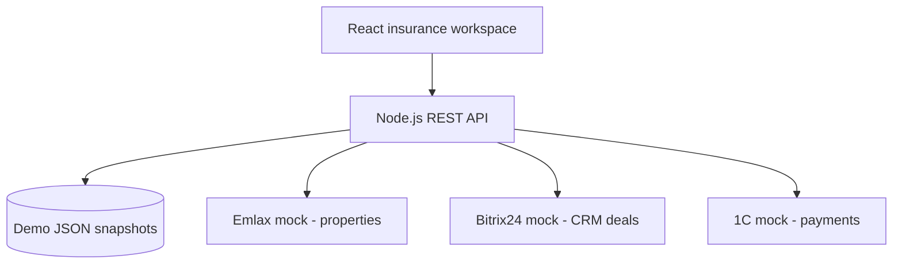

# InsureFlow — Insurance Management Portal

A full-stack portfolio demo that brings everyday insurance operations into a simple six-section workspace. Built with React, TypeScript and Node.js on the MIT-licensed [Shadcn Admin](https://github.com/satnaing/shadcn-admin) template.

> Independent educational project. All records, premiums, payments and integration responses are fictional. Emlax, Bitrix24 and 1C are simulated locally; this is not an official product or a connection to any real insurer or vendor. Do not enter personal or financial information.

## Features

| Workspace | Capabilities |
| --- | --- |
| Dashboard | Live demo KPIs, policy distribution, integration health and quick actions |
| Customers | Search and register fictional customers |
| Insurance | Policies, illustrative premium calculator, reserved properties and applications |
| Claims | Create claims against active policies and update their status |
| Payments | Review simulated financial records and matching status |
| Integrations | Monitor mock systems, CRM deals and retry history |

## Technology and architecture

- React 19, TypeScript, Vite, Tailwind CSS, shadcn/ui, TanStack Router and Query.
- Node.js HTTP server, JSON snapshots and three separate mock HTTP services.
- Same-origin REST API: Vite proxy for development; Node serves the compiled frontend in hosted mode.
- Idempotent application creation, serialized writes, CRM retry tracking, exact payment reconciliation and policy issuance checks.



## Run locally (Windows / PowerShell)

Requirements: Node.js 24 recommended, pnpm 12.23.0, Git optional. Open the project root in VS Code.

Terminal 1 — backend (no external packages needed):

```powershell
cd backend
npm.cmd start
```

Terminal 2 — frontend (install only on first run):

```powershell
cd frontend
pnpm.cmd install --frozen-lockfile
pnpm.cmd run dev
```

Open <http://localhost:5173>. Keep both terminals running. Stop with Ctrl+C. On macOS/Linux, use `npm` and `pnpm` instead of the `.cmd` executables.

| Service | Local port |
| --- | --- |
| Frontend | 5173 |
| API | 3001 |
| Emlax mock | 4101 |
| Bitrix24 mock | 4102 |
| 1C mock | 4103 |

## Demo walkthrough

1. Open **Insurance → Applications**, choose a reserved property and create an application.
2. Sync CRM to create a simulated Bitrix24 deal. A simulated failure can be retried safely.
3. Generate a demo payment, match it with the application, and issue the policy.
4. Review the issued policy, payments and integration history. Incorrect or duplicate payments require review and can be cleared before retrying.
5. Use **Claims** to submit a fictional claim for an active policy and update its status.

## Verification

From `backend`, run `npm.cmd test` (15 automated tests, including local and hosted HTTP flows). From `frontend`, run `pnpm.cmd run build`. The original completed frontend passed TypeScript validation; the final hosted configuration has not been built or deployed in the packaging environment. The hosted HTTP test uses a minimal static-file fixture, not the compiled React app.

## Deployment and design notes

See [deployment instructions](docs/DEPLOYMENT.md) and [API and design notes](docs/ARCHITECTURE.md). A Dockerfile and Render Blueprint are included for a password-protected hosted demonstration. No live URL is claimed until deployment is verified.

## Limitations

This demo has no production account system, authorization roles, real payment processing, insurer underwriting or database migration strategy. The hosted access gate is shared HTTP Basic authentication, not individual user accounts. Hosted free-instance data is temporary and shared among invited viewers. Use fictional data only. A production system would require secure identity, per-user permissions, a real database, audit controls and verified vendor contracts.

## Credits and license

UI foundation: [Shadcn Admin by Sat Naing](https://github.com/satnaing/shadcn-admin), MIT. The original license is preserved in `frontend/LICENSE` and copied to the root `LICENSE`. The insurance workflow and project-specific modifications were developed with AI assistance and should be reviewed before reuse. Third-party packages retain their own licenses.
